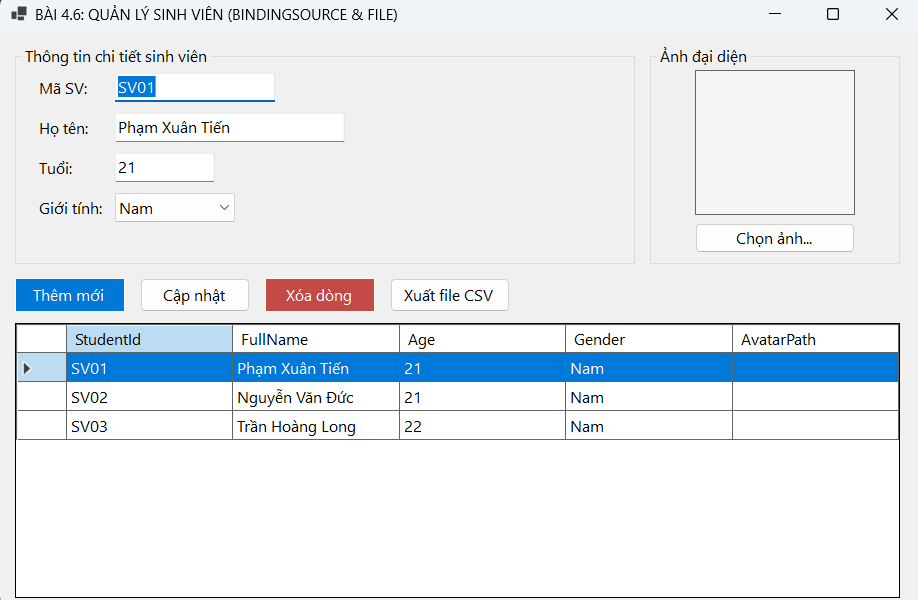
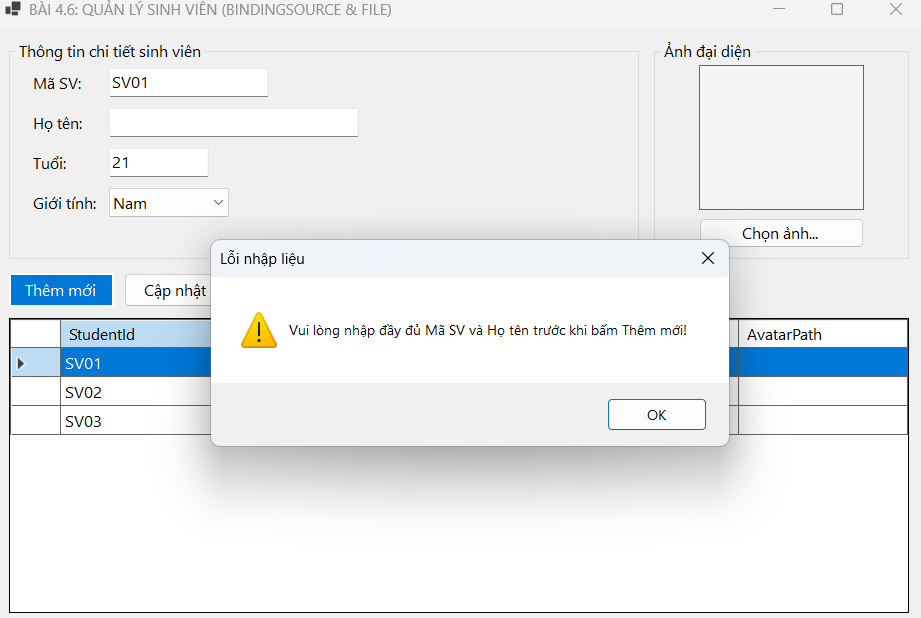
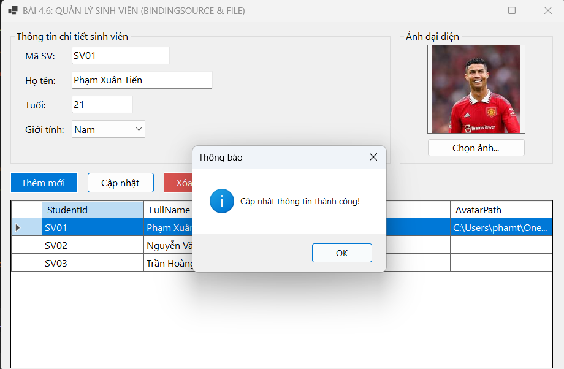
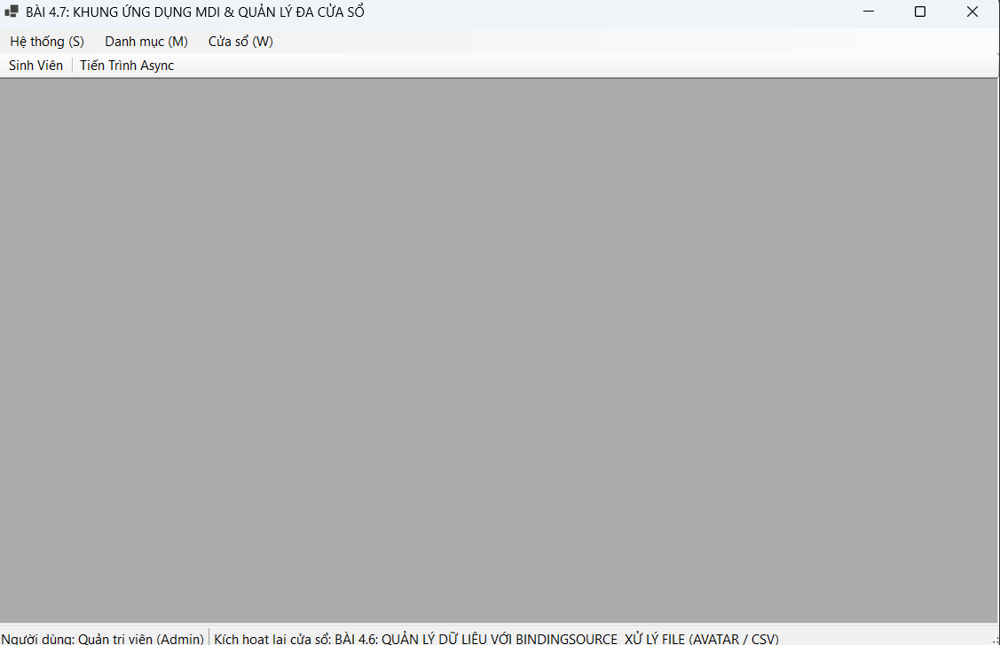
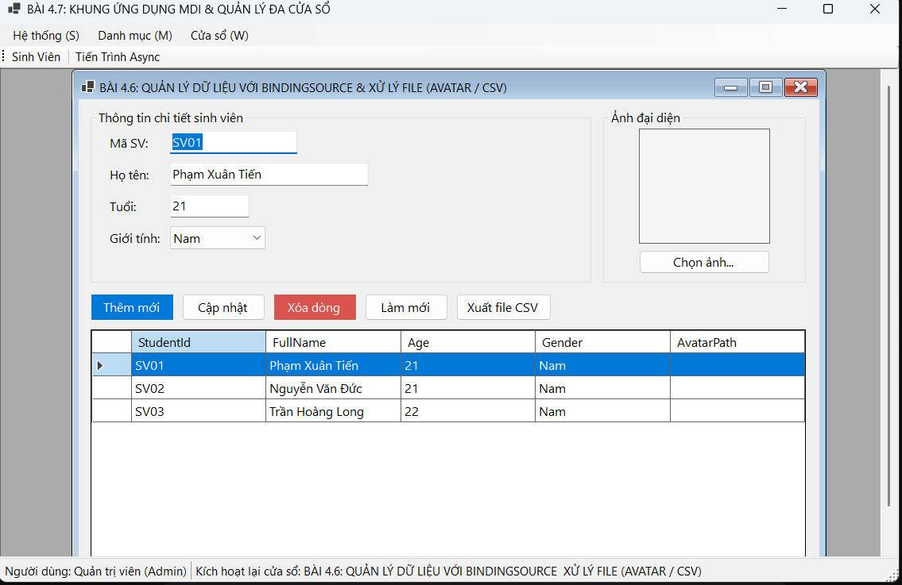
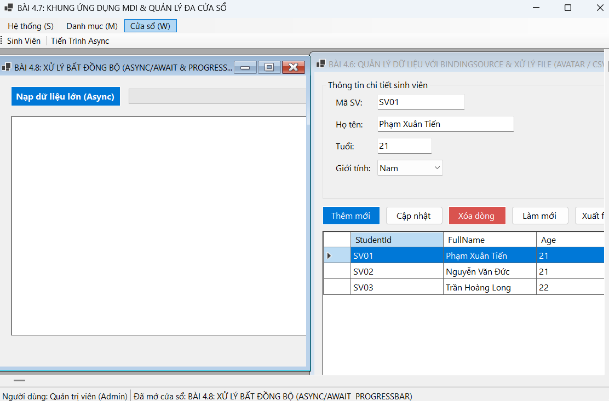
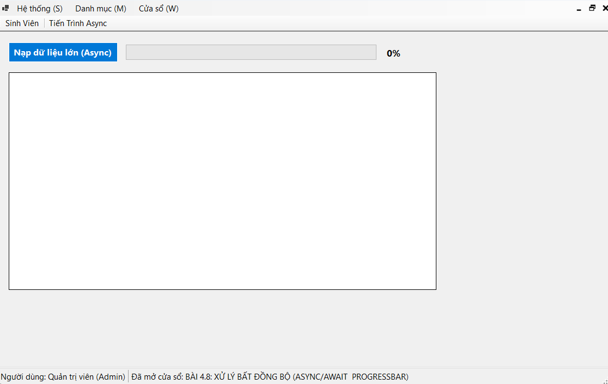
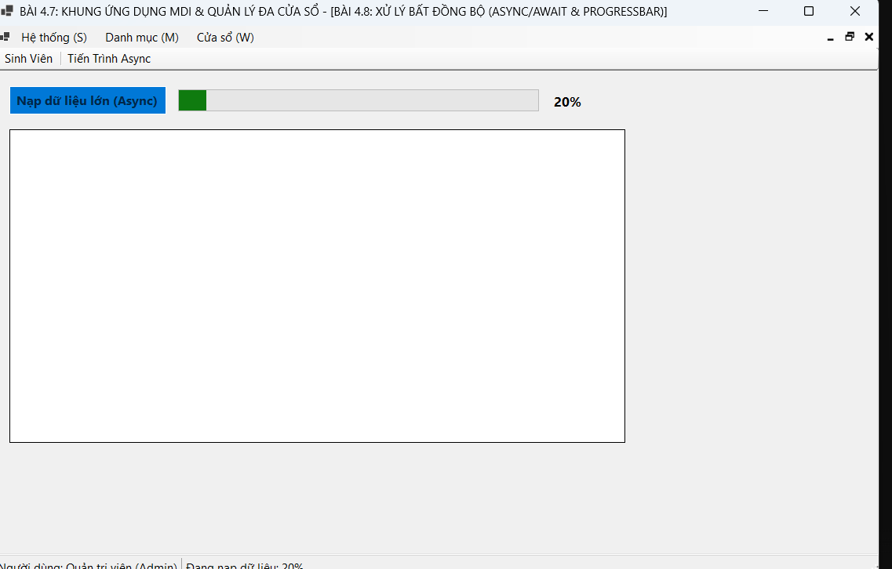
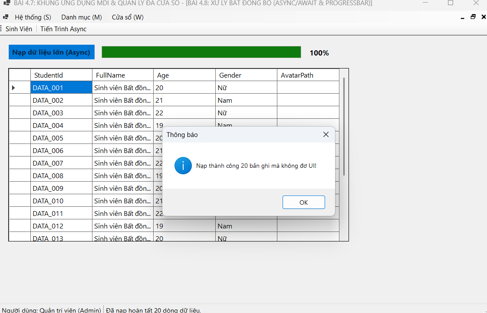

# BÁO CÁO THỰC HÀNH LẬP TRÌNH WINDOWS FORMS - BÀI TẬP 4

## THÔNG TIN SINH VIÊN
- **Họ và tên:** Phạm Xuân Tiến
- **Mã số sinh viên:** 24810320273
- **Lớp:** D19QTANM1
- **Tên môn học:** Lập trình C# / Windows Forms
- **Tên bài tập:** Thực hành Bài 4 (4.6, 4.7, 4.8)

---

## KẾT QUẢ THỰC HÀNH

### BÀI 4.6: QUẢN LÝ DỮ LIỆU VỚI BINDINGSOURCE & XỬ LÝ FILE (AVATAR / CSV)
1. **Giao diện chính (UI):**
   
2. **Kiểm tra bắt lỗi hợp lệ (Error Validation):**
   
3. **Kết quả thao tác (Result - Chọn ảnh / Xuất CSV):**
   

---

### BÀI 4.7: THIẾT KẾ KHUNG ỨNG DỤNG MDI & QUẢN LÝ ĐA CỬA SỔ
1. **Giao diện khung MDI chính (UI):**
   
2. **Xử lý ngăn chặn mở trùng lặp Form con (Error Prevention):**
   
3. **Kết quả điều hướng đa cửa sổ & Sắp xếp (Result):**
   

---

### BÀI 4.8: LẬP TRÌNH BẤT ĐỒNG BỘ (ASYNC/AWAIT & PROGRESSBAR)
1. **Giao diện ban đầu (UI):**
   
2. **Khóa thao tác tránh kích hoạt trùng lặp (Error Prevention):**
   
3. **Kết quả nạp dữ liệu hoàn tất & ProgressBar (Result):**
   
